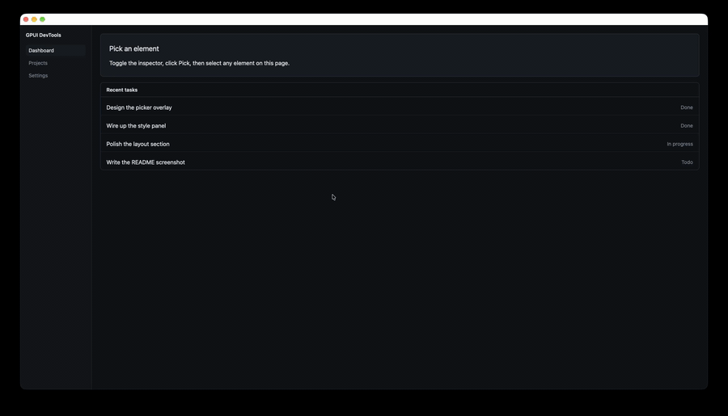

# gpui-devtools

[](https://github.com/joris-gallot/gpui-devtools/actions/workflows/ci.yml)
[](https://crates.io/crates/gpui-devtools)
[](LICENSE)

Inspect and debug [GPUI](https://gpui.rs) applications with an element picker, layout information, source locations, computed values, and style details.



The inspector includes:

- an element picker
- source locations and GPUI element IDs with copy actions
- a box model view with element bounds, content size, margin, border, and padding
- a computed values panel with measured bounds, content size, explicit dimensions, spacing, opacity, visibility, and background
- temporary quick style edits for the selected `Div`, including presets, incremental size/spacing/opacity controls, background, visibility, reset, and copy/export actions
- grouped `Div` style refinements with compact spacing and color previews
- a Keyboard tab with the focus state, the key context stack, available actions with their active bindings, pending multi-stroke input, the 20 most recent keystrokes and the action each one triggered, and a copyable text report
- a global toggle action and optional default keybinding

## Install

```toml
[features]
devtools = ["dep:gpui-devtools", "gpui/inspector"]

[dependencies]
gpui = { package = "gpui-pre", version = "0.3" }
gpui-devtools = { version = "0.6", optional = true }
```

GPUI DevTools 0.6 targets [`gpui-pre`](https://crates.io/crates/gpui-pre) 0.3, the crates.io snapshot of Zed's GPUI also used by [gpui-kit](https://github.com/longbridge/gpui-kit). Your application must resolve to the same GPUI crate, otherwise Cargo builds two incompatible copies.

Since 0.5.2, GPUI DevTools requires `gpui-pre` 0.3.11 or later and Rust 1.98 or later.

| gpui-devtools | GPUI |
| --- | --- |
| 0.6 | `gpui-pre` 0.3 |
| 0.5 | `gpui-pre` 0.3 |
| 0.4 | `gpui-pre` 0.3 |
| 0.3 | `gpui-pre` 0.3 |
| 0.2 | `gpui` 0.2 |

## Use

```rust
app.run(|cx| {
    // Initialize the rest of the app first.

    #[cfg(feature = "devtools")]
    gpui_devtools::init(cx);
});
```

Install GPUI DevTools after libraries that register their own inspector renderer.

The default shortcut is `cmd-alt-i` on macOS and `ctrl-alt-i` elsewhere. You can dispatch `gpui_devtools::ToggleInspector` yourself or customize installation:

```rust
gpui_devtools::init_with(
    gpui_devtools::Config::default().key_binding(None),
    cx,
);
```

## Keyboard inspection

The Keyboard tab shows what GPUI sees from the focused element: the key contexts from the window root to the focus, the actions available there, and the binding that would trigger each one. Keystrokes are recorded per window, together with the action they triggered and the context stack at the time. A keystroke shows "no action" when no binding matched or when no handler on the focus path handled the action.

Clicks on the panel are ignored while picking, so select an element before you switch tabs. GPUI does not expose which element owns the focus, so the panel only tells you whether something is focused.

## Roadmap

- deeper style inspection and live editing
- better element navigation, selection, and source discovery
- visual debugging helpers such as repaint and layout overlays
- event inspection beyond keystrokes
- render, layout, and paint diagnostics
- entity and lifecycle debugging tools

## License

[MIT](LICENSE)
